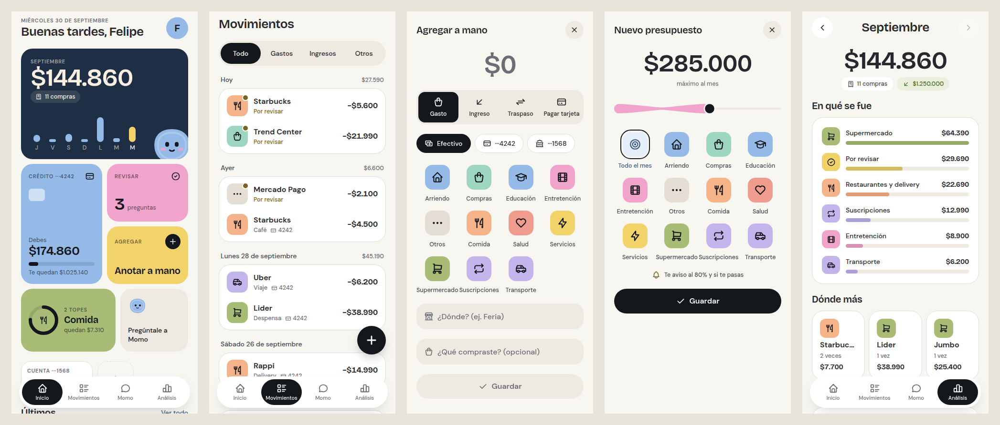

# Duplicia

Apps con IA integrada, hechas en Chile.

**Momo** es la primera: una app de finanzas personales que registra tus gastos leyendo los avisos que te manda el banco. Reenvías esos correos y cada compra aparece sola, con su comercio y su categoría. Encima tiene un asistente que responde preguntas sobre tus gastos, presupuestos con avisos y gastos compartidos con amigos.

Momo está en desarrollo para iOS y Android.

Fundada por [Felipe González](https://github.com/felipegpassi).
